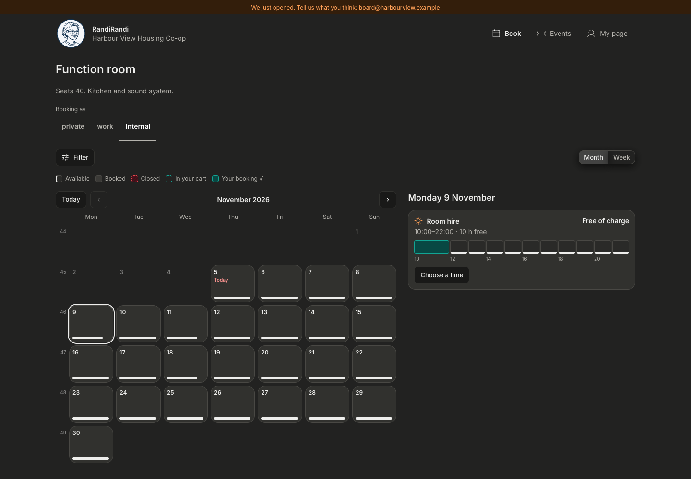
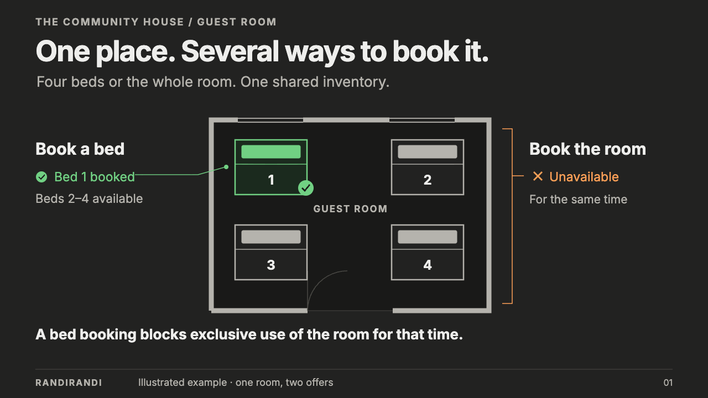
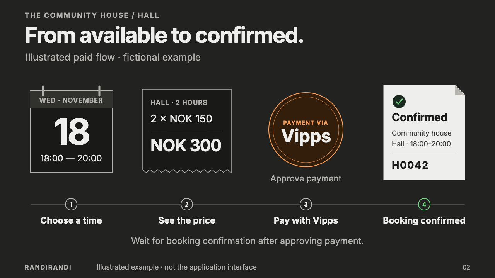

<!-- SPDX-License-Identifier: CC-BY-SA-4.0 -->
<p align="center"></p>

# RandiRandi

**Open-source booking and payments for the things you share.**

For associations and small organizations running a community hall, guest rooms,
a laundry, a sauna or equipment hire. Members find a time, see the price and
book. Administrators manage access, availability, bookings and refunds.

[Run locally](docs/running.md) · [Watch a booking](docs/booking-video.md) · [Illustrated guide](docs/illustrated-guide.md) · [Documentation](#documentation)

[](docs/booking-video.md)

*The actual application, with fictional members and bookings.*

## One place. Several ways to book it.

Offer a single bed or the whole guest room. Both use the same physical
inventory: booking one bed blocks exclusive use of the room for that time.
The other beds remain available.



Fixed sessions, flexible times, shared capacity and exclusive use fit the same
model. Your organization sets the opening hours, booking rules, roles and prices.

## Booking through to payment

Choose a time, review the price and confirm. Paid bookings use Vipps; free
bookings need no payment provider. Members can find their bookings again.
Administrators can cancel bookings and follow refunds through to completion.



*Illustrated paid example. [Watch an actual free booking](docs/booking-video.md)
or [see the member and administrator screens](docs/product-walkthrough.md).*

- **Members:** calendar, cart, confirmation, booking history and email.
- **Administrators:** configuration, members, events, access, payments and refunds.
- **Sign-in:** email codes, with an authenticator for administrators.
- **Languages:** English and Norwegian, with organization-specific labels.
- **Data:** audit history, retention rules, member export and portable configuration.

This is an early product. Vipps is the current payment provider; paid event
attendance is not implemented.

## Try it locally

```sh
git clone https://github.com/Randibooking/randirandi.git
cd randirandi
bin/example
```

The command builds a local stack, loads a fictional organization and members,
and sets up the first administrator. A free sample booking needs no Vipps
credentials. See [Running locally](docs/running.md) for browser certificate
trust, sign-in, reset and shutdown.

Requires Docker with Compose, Node 22.12+, `uv`, Git and OpenSSL.
`uv` installs Python 3.14; the first build downloads pinned dependencies.

Claypond AS also offers managed hosting. To discuss it, email
[post@randirandi.com](mailto:post@randirandi.com). Self-hosted instances use
their own domain, brand and operating setup, including email, backups and
security. See [operating responsibilities](docs/running.md#operating-your-own-instance).

## Documentation

| Guide | Contents |
| --- | --- |
| [Illustrated guide](docs/illustrated-guide.md) | Fourteen explanations of places, rules and booking |
| [Booking model](docs/booking-model.md) | Offers, shared inventory, availability and pricing |
| [Setup files](docs/setup-file.md) | Configure an organization without changing code |
| [Data model](docs/data-model.md) | Ownership, relationships, transactions and personal data |
| [Running](docs/running.md) | Local evaluation and self-hosting |
| [Development](docs/contributing.md) | Source layout, conventions and checks |
| [Contributing](CONTRIBUTING.md) | Reports, suggestions and contribution policy |
| [Security](SECURITY.md) | Private vulnerability reporting |

Django and PostgreSQL on the server; React and MUI in the browser.
`bin/setup` installs development dependencies and the commit hook.
`bin/check` runs the build, tests, type checks and licence/security checks.

Bug reports and suggestions are welcome. Outside code and documentation
contributions are currently closed; see [Contributing](CONTRIBUTING.md).

## Licence and brand

Copyright Claypond AS. Code and included RandiRandi artwork are
[AGPL-3.0-only](LICENSE); documentation is [CC BY-SA 4.0](LICENSE-docs).
Dependencies retain their own terms and [notices](licenses/README.md).

The RandiRandi name and portrait logo are Claypond's trademarks. The artwork's
copyright licence does not grant trademark rights; see [Trademarks](TRADEMARKS.md).
[Different licensing terms](docs/commercial-licence.md) are available by agreement.
