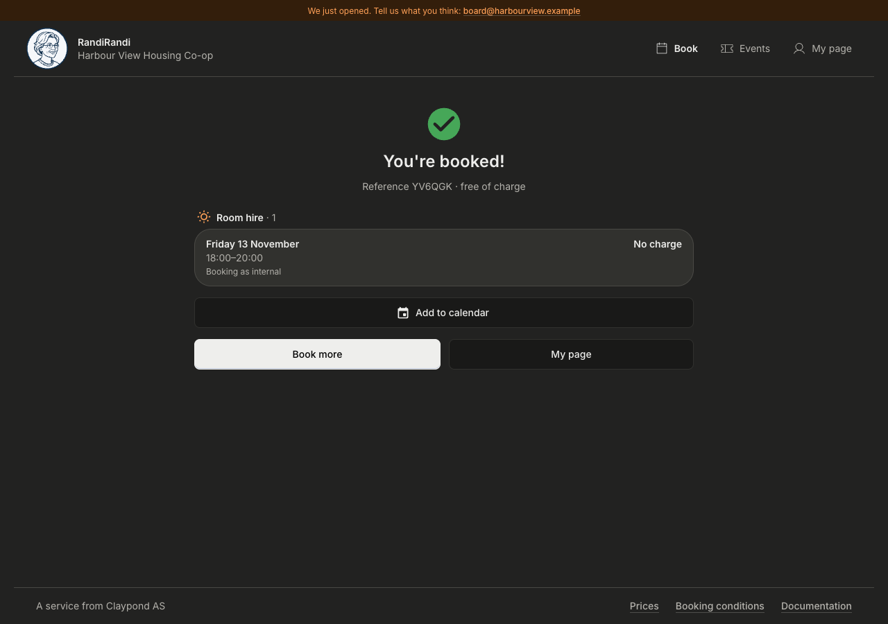

<!-- SPDX-License-Identifier: CC-BY-SA-4.0 -->
# Watch a free booking

[Play or download (WebM)](media/free-booking.webm) · [Captions](media/free-booking.vtt) · [Screenshots](product-walkthrough.md)

A continuous recording of the English application, from choosing a time to
finding the confirmed booking on My page. The organization and members are
fictional. The member is already signed in; the booking is free, so no payment
provider is involved. No audio.

## Transcript

| Time | Action |
| --- | --- |
| 00:00 | Start in the member calendar. |
| 00:04 | Choose Friday 13 November in Function room. |
| 00:07 | Open Room hire and select the free internal category. |
| 00:10 | Choose 18:00–20:00 and check the price: no charge. |
| 00:14 | Add the selection to the cart. |
| 00:17 | Review the booking and conditions. |
| 00:20 | Accept the conditions and confirm. |
| 00:23 | Receive confirmation, reference YV6QGK. |
| 00:27 | Find the booking on My page. |

The [paid-booking illustration](images/booking-journey.png) explains the separate
Vipps payment step. This recording demonstrates the free-booking path.
