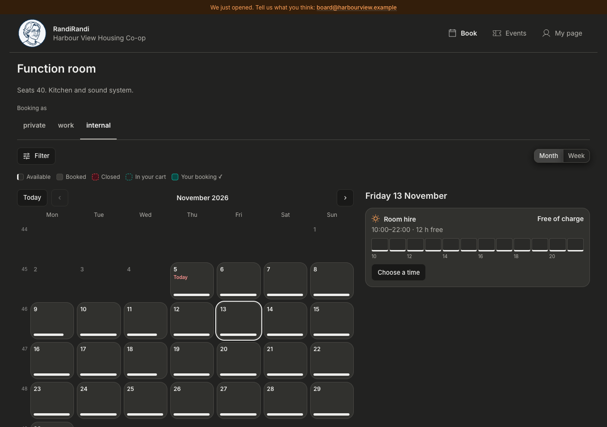
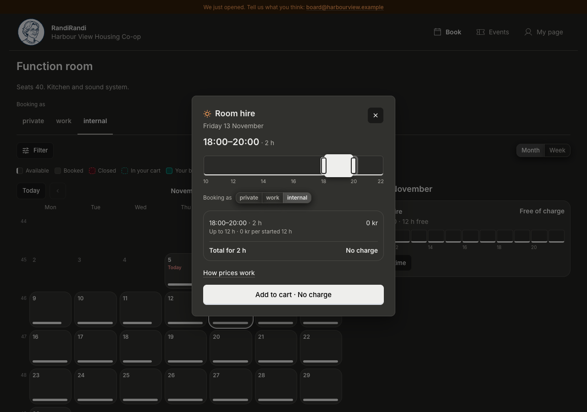
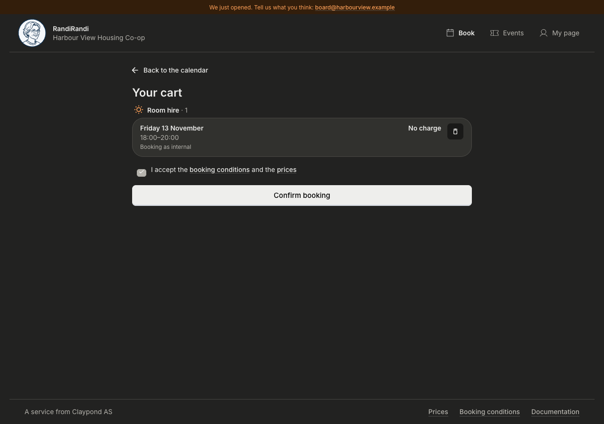
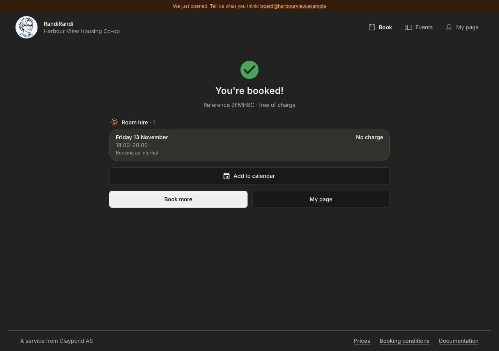
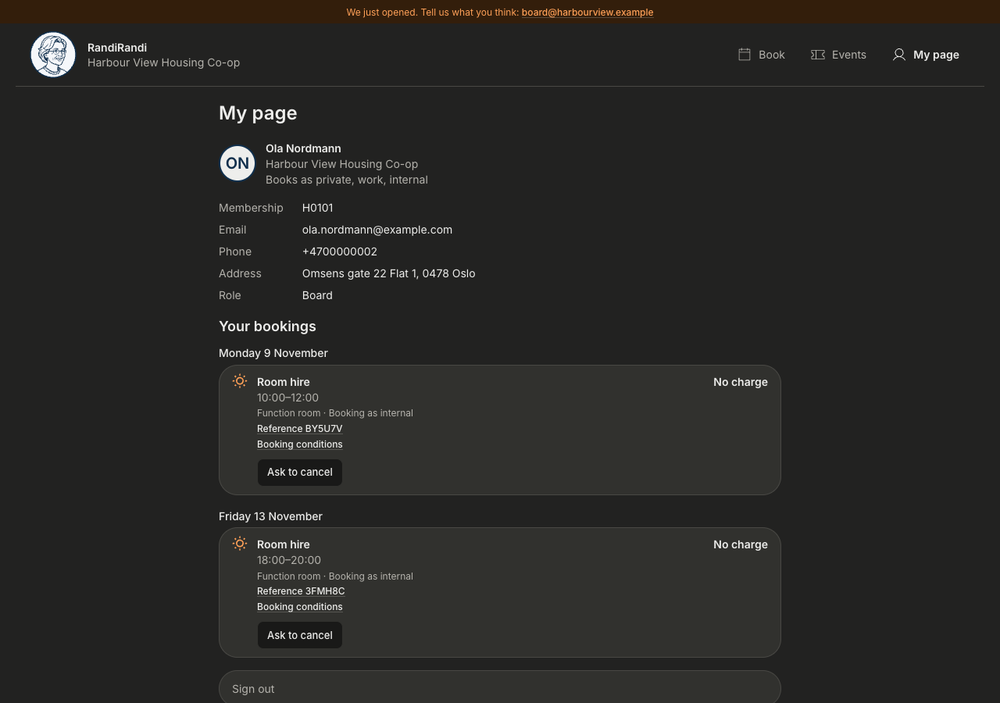
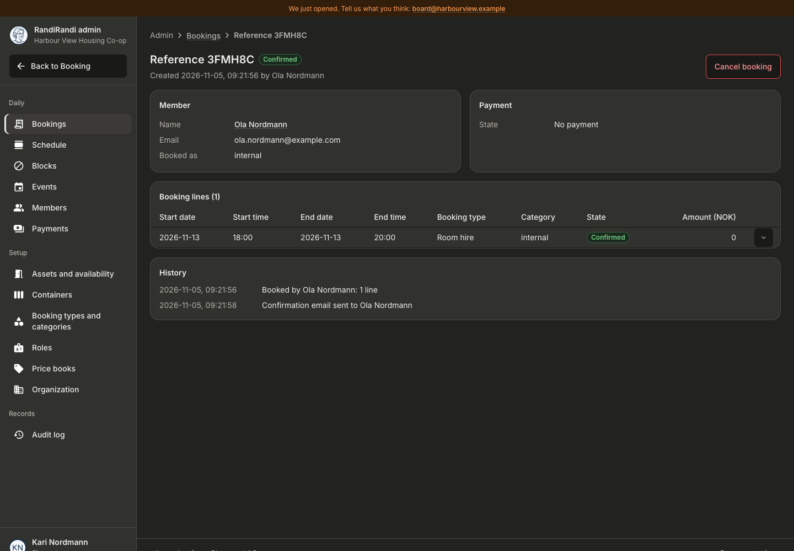

<!-- SPDX-License-Identifier: CC-BY-SA-4.0 -->
# A real free booking

Five screenshots from the actual English application, using the fictional
Harbour View Housing Co-op setup and bundled dummy members. The member creates
one free Function room booking for 13 November 2026, 18:00–20:00. The same
booking appears in the member’s history and in Admin.

This is a sequence of captured states, not a continuous recording. Sessions
were seeded for this local exercise; it does not demonstrate sign-in, MFA,
email delivery, Vipps payment or a production deployment.

[Back to the introduction](../README.md) · [Try it locally](running.md)

## 1. Choose a day

The member selects Friday 13 November in the Function room calendar.

## 2. Check the time and price

The internal offer permits a free booking from 18:00 to 20:00.

## 3. Review the cart

The member reviews the booking and accepts the conditions before confirming.

## 4. Receive confirmation

The application confirms reference 3FMH8C for 18:00–20:00, with no charge.

## 5. Find the booking again

The new confirmed booking appears on the member’s own page.

## The administrator’s view

Admin shows the same confirmed booking, its fictional member, its time and
an amount of zero. The email-history entry comes from the local console backend;
it is not evidence of external delivery.

[Booking list](images/admin-bookings-desktop.png) · [Member calendar on a phone](images/member-calendar-mobile.png)
